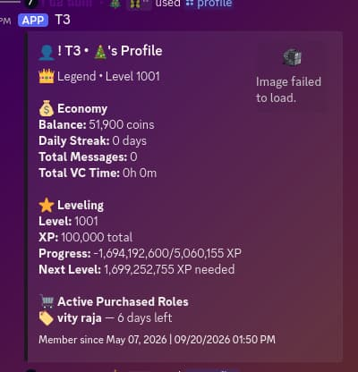
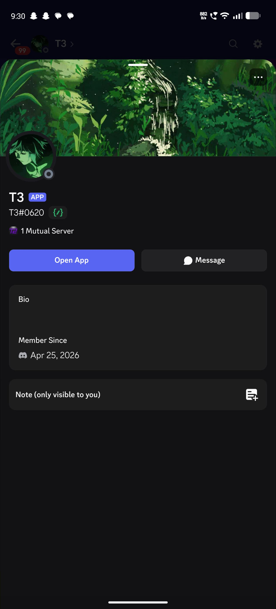
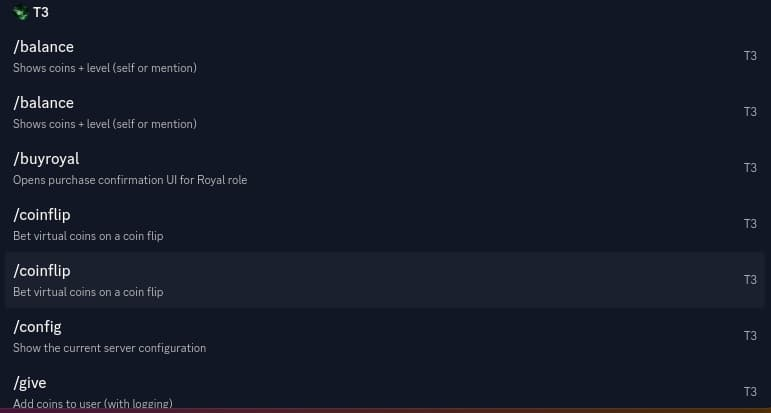
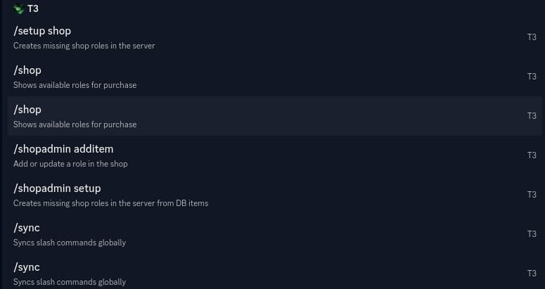
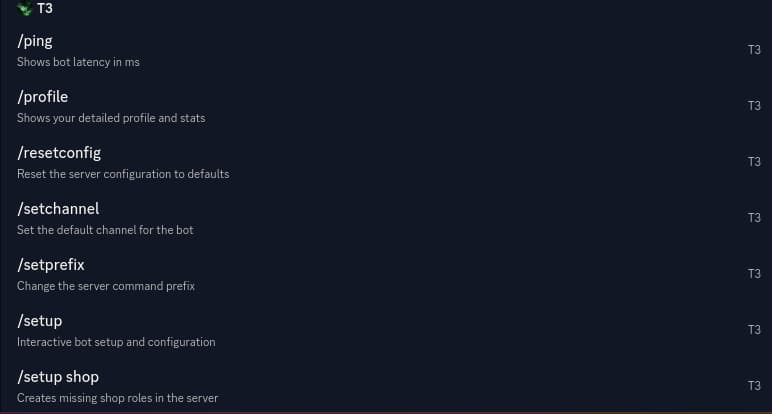
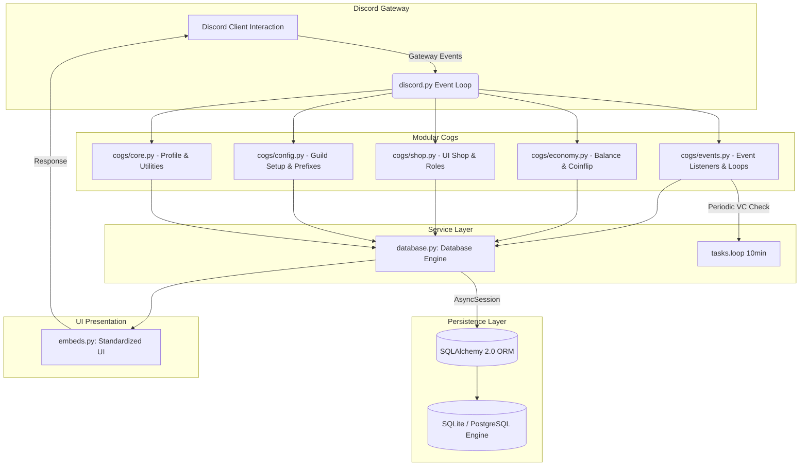
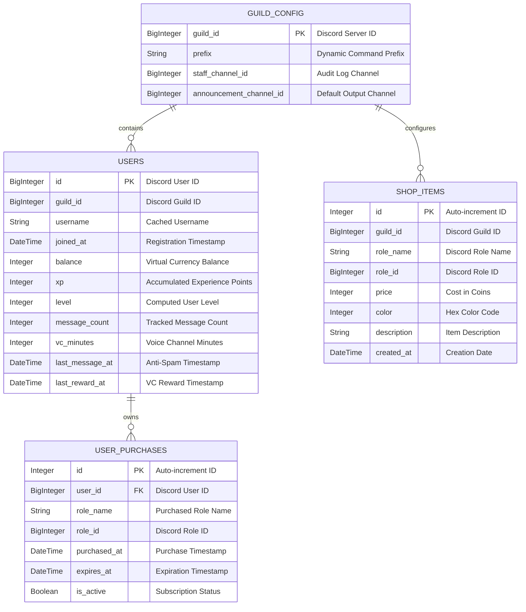

<div align="center">

# 🎙️ Discord Temp VC & Economy Bot (T3)
### Enterprise-Grade Asynchronous Discord Bot with Dynamic Economy, Voice Tracking, and Role Monetization

[](https://www.python.org/)
[](https://discordpy.readthedocs.io/)
[](https://www.sqlalchemy.org/)
[](https://github.com/omnilib/aiosqlite)
[](#system-architecture)
[](https://opensource.org/licenses/MIT)

*A production-ready Discord application engineered to showcase modern Python backend competencies: asynchronous concurrency, ORM database modeling, event-driven reactive programming, and modular clean architecture.*

[Live Features](#key-features) • [System Architecture](#system-architecture) • [Database Schema](#database-design) • [Visual Showcase](#visual-showcase) • [Installation](#getting-started) • [Contact](#author--career-inquiries)

---

</div>

## 📌 Project Overview

**Discord Temp VC & Economy Bot** is a high-performance Discord application designed to drive community engagement through gamification. The bot automatically tracks voice channel participation, monitors chat activity with anti-spam rate limiting, rewards virtual currency and XP, provides interactive betting mini-games, and offers a fully automated role shop with expiring timed subscriptions.

Developed as a portfolio centerpiece for **Python / Backend Developer** roles, this project highlights:
- **Asynchronous Concurrency**: Non-blocking network I/O and background task scheduling using `asyncio` and `discord.py` 2.0+.
- **Modern Async ORM**: Full persistence layer built with `SQLAlchemy 2.0` (AsyncSession) and `aiosqlite`, providing database engine agnostic compatibility (SQLite, PostgreSQL, MySQL).
- **Component-Driven UI/UX**: Native Discord UI components (`discord.ui.View`, interactive buttons, select dropdowns, and modals).
- **Production Architecture**: Modular Cog structure, multi-tenant per-guild configuration, and deployment manifests for cloud hosting (Railway / Nixpacks).

---

## 📸 Visual Showcase

<div align="center">

### Detailed User Profile & Economy Statistics
*Dynamic embed displaying balance, leveling curve, active purchased role subscriptions, and engagement metrics.*



<br/><br/>

### Bot Identity & Modern Slash Command Suite
*Discoverable, type-safe Discord interactions powered by `@app_commands`.*

| Bot Identity | Economy & Admin Commands |
| :---: | :---: |
|  |  |

| Shop & Item Administration | Utility & Per-Guild Setup |
| :---: | :---: |
|  |  |

</div>

---

## 🏗️ System Architecture

The application adopts an **Event-Driven, Modular Cog Architecture** separating command handling, business logic, and persistent storage.



### Architectural Highlights
1. **Asynchronous Non-Blocking Execution**: All database queries and external API calls utilize `async/await` syntax, ensuring the Discord gateway websocket connection never starves or drops heartbeat packets.
2. **Modular Cog Design**: Features are isolated into self-contained modules (`commands.Cog`), allowing independent maintenance, debugging, and runtime hot-reloading.
3. **Multi-Tenant Guild Isolation**: Per-server configuration (`GuildConfig`) enables dynamic prefix handling, custom announcement channels, and dedicated administrative audit logs.

---

## 🗄️ Database Design

The data layer uses **SQLAlchemy 2.0 Async ORM** with clean relational models and transactional safety:



---

## ⚡ Key Features & Engineering Implementation

### 1. 🎙️ Intelligent Voice Channel Activity Engine
- **Active Participant Detection**: Background daemon loop (`@tasks.loop(minutes=10)`) continuously evaluates connected voice members.
- **AFK / Deafen Shield**: Automatically verifies `if not member.voice.self_deaf` to reward actively listening members rather than idle or muted users.
- **Atomic Balance Updates**: Safely increments coin balances and calculates level promotions atomically inside async database sessions.

### 2. 💬 Chat Engagement & Anti-Spam Cooldown
- **Dynamic Message Engine**: Rewards currency on chat activity (1 coin per 10 active messages).
- **In-Memory Rate Limiting**: Enforces a 30-second sliding cooldown window (`last_message_at`) per user to eliminate spam exploitation.

### 3. 📈 Leveling & Mathematical Progression
- **Exponential Level Curve**: Computes user rank and level requirements dynamically.
- **Level-Up Notifications**: Dispatches celebratory embed alerts to designated server channels upon promotion milestones.

### 4. 🛒 Interactive Role Shop & Expiring Subscriptions
- **Discord UI Components**: Built using `discord.ui.View` and interactive buttons.
- **Automated Role Provisioning**: Direct Discord API integration (`member.add_roles()`) with permission safety checks.
- **Timed Expiry Engine**: Tracks `expires_at` timestamps to manage temporary VIP/Royal role memberships.
- **Audit Logging**: Emits real-time administrative audit logs to designated staff channels upon each transaction.

### 5. 🎲 Economy & Mini-Games
- `/balance`: Displays personal currency, level, and progression bar.
- `/top`: Optimized database query retrieving the top 10 richest guild members.
- `/coinflip`: Cryptographically secure 50/50 probability gambling mechanism with balance validation.
- `/give` & `/take`: Privileged administrative currency management commands with audit logging.

---

## 💻 Code Quality & Python Best Practices

### Asynchronous Repository Pattern
```python
async def get_or_create_user(self, user_id: int, guild_id: int, username: str) -> User:
    """Fetch user record or instantiate a new record asynchronously."""
    async with self.Session() as session:
        result = await session.execute(
            select(User).where(User.id == user_id, User.guild_id == guild_id)
        )
        user = result.scalar_one_or_none()
        if not user:
            user = User(id=user_id, guild_id=guild_id, username=username)
            session.add(user)
            await session.commit()
            await session.refresh(user)
        return user
```

### Discord UI Component with Transactional Verification
```python
class ShopView(discord.ui.View):
    def __init__(self, bot, items):
        super().__init__(timeout=180)
        self.bot = bot
        # Dynamically inject purchase buttons per shop item
        for item in items:
            self.add_item(ShopPurchaseButton(bot, item))
```

---

## 🛠️ Technology Stack

| Domain | Technology | Purpose |
| --- | --- | --- |
| **Language** | Python 3.10+ | Primary development language |
| **Framework** | `discord.py` 2.3+ | Asynchronous Discord API wrapper |
| **Database ORM** | `SQLAlchemy 2.0 (asyncio)` | Database abstraction and ORM modeling |
| **Async DB Driver**| `aiosqlite` | Non-blocking SQLite connector |
| **Image Processing**| `Pillow` (PIL) | Dynamic profile card generation |
| **Configuration** | `python-dotenv` | Twelve-factor app environment configuration |
| **Deployment** | `Railway` / `Nixpacks` | Containerized cloud hosting |

---

## 🚀 Getting Started

### Prerequisites
- Python 3.10 or higher
- A Discord Bot Application Token ([Discord Developer Portal](https://discord.com/developers/applications))

### Installation

1. **Clone the repository**:
   ```bash
   git clone https://github.com/aswin18antony-code/discord-temp-vc-bot.git
   cd discord-temp-vc-bot
   ```

2. **Create and activate a virtual environment**:
   ```bash
   python3 -m venv venv
   source venv/bin/activate  # On Windows: venv\Scripts\activate
   ```

3. **Install dependencies**:
   ```bash
   pip install -r requirements.txt
   ```

4. **Configure Environment Variables**:
   Copy the example environment file and add your credentials:
   ```bash
   cp .env.example .env
   ```
   Edit `.env`:
   ```env
   DISCORD_TOKEN=your_bot_token_here
   COMMAND_PREFIX=!
   DATABASE_PATH=bot.db
   STAFF_CHANNEL_ID=your_audit_log_channel_id
   ROLE_DURATION_DAYS=30
   ```

5. **Run the bot**:
   ```bash
   python bot.py
   ```

---

## ☁️ Deployment

### Deploy to Railway / Cloud
The project includes ready-to-use configuration files for seamless cloud deployment:
- `railway.json`: Deployment lifecycle definitions
- `nixpacks.toml`: Python runtime and system package specifications

Simply connect your GitHub repository to [Railway](https://railway.app), attach a persistent volume mounted to `/app`, configure your environment variables in the Railway dashboard, and deploy!

---

## 👤 Author & Career Inquiries

**Aswin Antony**  
*Python / Backend Developer*

- **GitHub**: [@aswin18antony-code](https://github.com/aswin18antony-code)
- **Primary Competencies**: Python, Asynchronous Programming (`asyncio`), REST APIs, Discord Bot Development, Database Modeling (SQLAlchemy / PostgreSQL / SQLite), Event-Driven Architecture, Cloud Deployment (Docker, Railway).

*Open to Junior / Mid-Level Python Developer, Backend Engineer, and Software Engineering positions.*

---

<div align="center">
<sub>Built with clean code, robust async patterns, and attention to detail.</sub>
</div>
